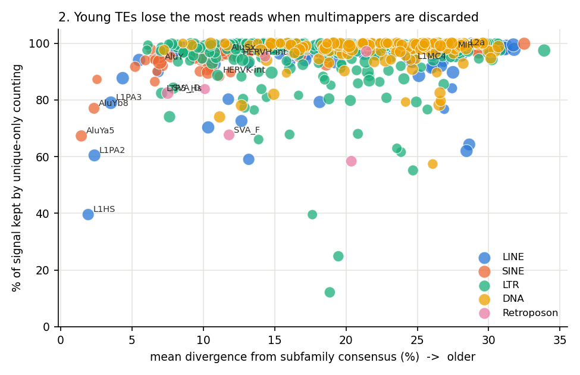
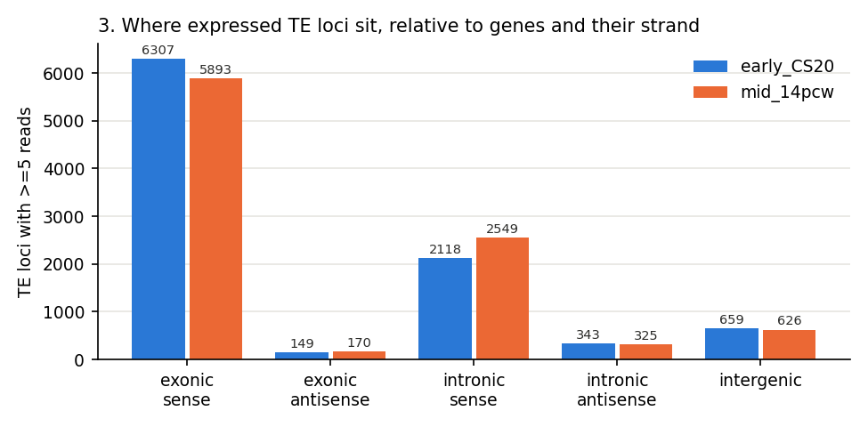
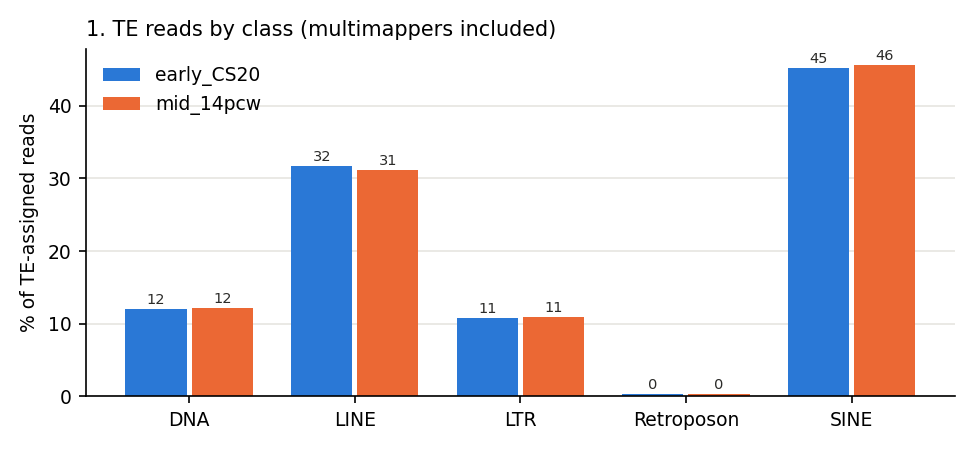

# Transposable element expression in the developing human brain: a demo

A reproducible pipeline that measures **transposable element (TE) expression** in prenatal
human brain RNA-seq, at **subfamily** and **locus** level. It shows what is lost when
multi-mapping reads are discarded, and separates TE loci that are likely transcribed on their
own from TE sequence carried inside host-gene transcripts. Because of my interest in autism,
it also looks at expressed TE loci inside **SFARI autism risk genes**.

**Data:** HDBR prenatal brain RNA-seq (ArrayExpress E-MTAB-4840), paired-end 100 bp,
reverse-stranded. Two samples, 4 million read pairs each (first 4M of each run):

| sample | stage | tissue | ENA sample / run |
|---|---|---|---|
| early_CS20 | Carnegie stage 20 (~7 post-conception weeks) | brain | ERS1221416 / ERR1473018 |
| mid_14pcw | 14 post-conception weeks | cerebral cortex | ERS1221652 / ERR1473257 |

n = 1 per stage, different regions: **descriptive only**, no statistical comparison.

## Key results

**1. About a third of apparent multimappers were reference artefacts.** The hg38 index contains
alternate-haplotype contigs (`_alt`); reads from those regions align equally well to the main
chromosome and the `_alt` copy. Removing `_alt` alignments made 32–35% of multimapped pairs
unique. True multimappers: 4.6% / 6.0% of read pairs.

**2. Young TE subfamilies lose most of their signal without multimappers.** Overall, including
multimappers adds only ~4% to TE counts, because most TE reads come from old, divergent copies
that map uniquely. But for young subfamilies, whose copies are nearly identical:

| subfamily | unique-only counting keeps |
|---|---|
| L1HS | 40% |
| L1PA2 | 60% |
| AluYa5 | 67% |
| SVA_F | 68% |
| AluYb8 | 77% |

**3. Most TE-derived reads come from host-gene transcripts.** Of 13,290 expressed TE loci
(≥5 read pairs), the large majority sit in exons or introns **on the same strand as a gene**,
consistent with TE sequence carried in mRNAs (e.g. 3′ UTRs) or pre-mRNA. The top subfamilies are
old SINEs (MIR, AluJ, AluS) and L2, typical of TE fragments embedded in genes. Loci more likely to
reflect **independent TE transcription** are the minority:

| context (expressed loci, ≥5 read pairs) | early_CS20 | mid_14pcw |
|---|---|---|
| exonic, same strand as gene | 6,307 | 5,893 |
| exonic, opposite strand | 149 | 170 |
| intronic, same strand as gene | 2,118 | 2,549 |
| intronic, opposite strand | 343 | 325 |
| intergenic | 659 | 626 |

Because the library is stranded, a read is counted on a TE only if it comes from the TE's own
strand; an antisense TE inside a gene therefore cannot be explained by that gene's transcript.

**4. Autism risk genes (SFARI, July 2026 release).** 1,125 expressed TE loci lie in 504 SFARI
genes, but 96% are on the same strand as the gene (likely the gene's own transcript). About 40
are antisense, in large neuronal genes such as *PTPRD* and *RBFOX1*: candidates for follow-up.

## Pipeline

| Script | Step | Tools |
|---|---|---|
| `00_annotations.sh` | GENCODE v44 genes; TE annotation built from UCSC RepeatMasker (hg38): subfamily, locus ID, family, class, divergence | awk |
| `01_get_reads.sh` | Stream the first 4M read pairs per sample from ENA | curl |
| `02_trim.sh` | Adapter/quality trimming and QC | fastp |
| `03_align.sh` | Whole-genome splice-aware alignment, up to 100 alignments per read | HISAT2 (`-k 100 --mm`) |
| `04_primary_only.py/.sh` | Drop `_alt`/unplaced-contig alignments, recompute NH | pysam |
| `05_count.sh` | Gene counts; TE counts at subfamily and locus level, unique-only vs multimappers (fractional, 1/NH) | featureCounts (`-s 2 -O --fraction [-M]`) |
| `06_analysis.sh/.py` | Subfamily age vs multimapper loss; locus context (exonic/intronic/intergenic × sense/antisense); SFARI overlap; figures | bedtools, pandas, matplotlib |

Figures and tables: `results/analysis/`.

## How to run

```bash
micromamba create -n te -c conda-forge -c bioconda hisat2=2.2.1 samtools=1.20 fastp=0.23.4 \
  subread=2.0.6 bedtools=2.31.1 python=3.11 pysam pandas matplotlib -y
micromamba activate te
pip install tabulate
# HISAT2 hg38 index: https://genome-idx.s3.amazonaws.com/hisat/hg38_genome.tar.gz -> ref/hg38/
for s in scripts/0[0-6]*.sh; do bash $s; done
```

SFARI genes (optional): download the gene list from SFARI Gene and save one symbol per line as
`ref/sfari_genes.txt`. The SFARI file is not redistributed here.

## Design choices and limitations

- **Whole-genome alignment.** Restricting to one chromosome would force reads from TE copies
  elsewhere onto that chromosome's copies, which badly distorts TE counts.
- **Fractional assignment, not EM.** Multimappers are split evenly (1/NH per alignment). EM-based
  tools (TEtranscripts, TElocal, Telescope) re-weight reads towards loci with more unique-read
  support; they did not fit within my VM's 4 GB per-machine memory limit (TEcount) or did not build
  on current Python (Telescope). Even splitting can assign reads to silent copies.
- **HISAT2 `--mm`** (memory-mapped index) for the same memory reason; alignments are identical.
- **Read-through.** Same-strand intronic loci may be unspliced pre-mRNA of the host gene, not
  independent TE transcription. Antisense and intergenic loci are better candidates.
- **Reference copies only.** Polymorphic TE insertions present in a donor but absent from hg38
  are not quantified; their reads are lost or assigned to reference copies.
- **SVA divergence** values from RepeatMasker are inflated by SVA's composite, repeat-rich
  structure, so SVA_F's "age" on the plot is not comparable to L1/Alu.
- **First 4M reads**, not a random subsample; n = 1 per stage; stages differ in region too.

## References

- Jin Y et al. (2015) TEtranscripts. *Bioinformatics* 31:3593.
- Bendall ML et al. (2019) Telescope. *PLoS Comput Biol* 15:e1006453.
- Liao Y et al. (2014) featureCounts. *Bioinformatics* 30:923.
- Kim D et al. (2019) HISAT2. *Nat Biotechnol* 37:907.
- Lindsay SJ et al. (2016) HDBR Expression: a unique resource for global and individual gene
  expression studies during early human brain development. *Front Neuroanat*.
- Playfoot CJ et al. (2021) Transposable elements and their KZFP controllers are drivers of
  transcriptional innovation in the developing human brain. *Genome Res* 31:1531.

Author: Vedika Goyal, VIT Vellore

## Figures

**What discarding multimappers costs, by TE age.** Each point is a subfamily; young subfamilies (left) lose the most signal with unique-only counting.



**Where expressed TE loci sit relative to genes and their strand.**



**TE reads by class.**


